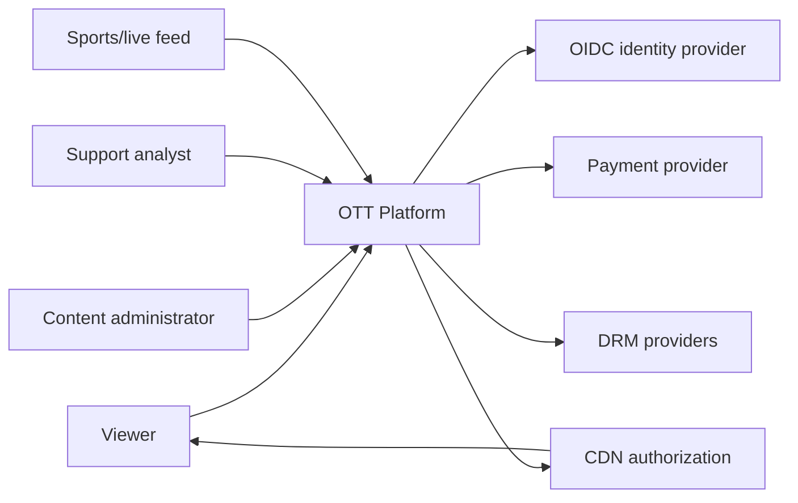
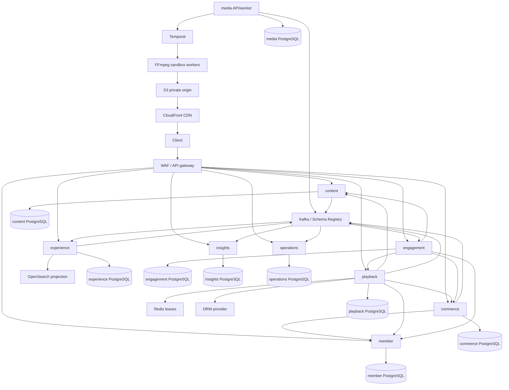
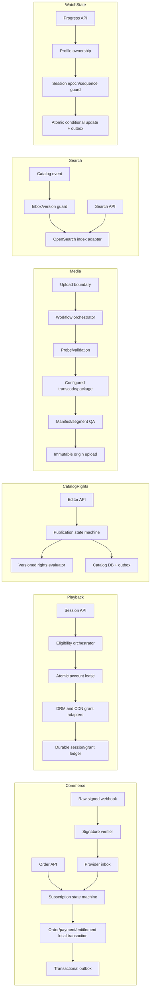

# C4 context, containers and dependency map

## Context

## Containers (target; optional components enter by phase)

Arrows represent synchronous dependencies except Kafka producer/consumer arrows. Gateway verifies JWT but every service independently validates issuer/audience and ownership. Content consumes media-ready asynchronously; media does not call content. Operations invokes owner commands; owners do not synchronously call operations. Playback fan-out depth is one owner hop. Experience checks member ownership and validated Playback grants; member never calls experience. No synchronous cycle exists.

## Components

Phase 6 sync edges: Experience → Member (viewer profile ownership), Content (published metadata/maturity), Playback (scoped grant context). Experience never reads another owner database and Playback never calls Experience.

Phase13 implemented synchronous Operations edges are only Member safe summary/security and Commerce security commands. Expanded cross-owner privacy/support orchestration in the original target map remains planned. The executable dependency validator uses actual owner edges and finds no synchronous cycles. Operations Kafka/source work never enters Playback's synchronous path.
