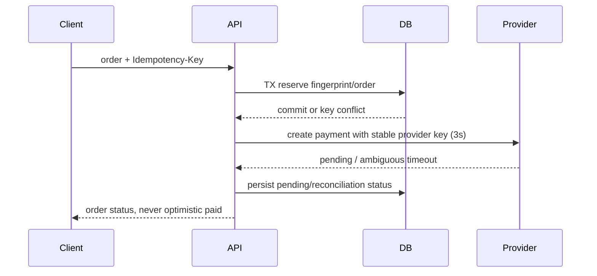
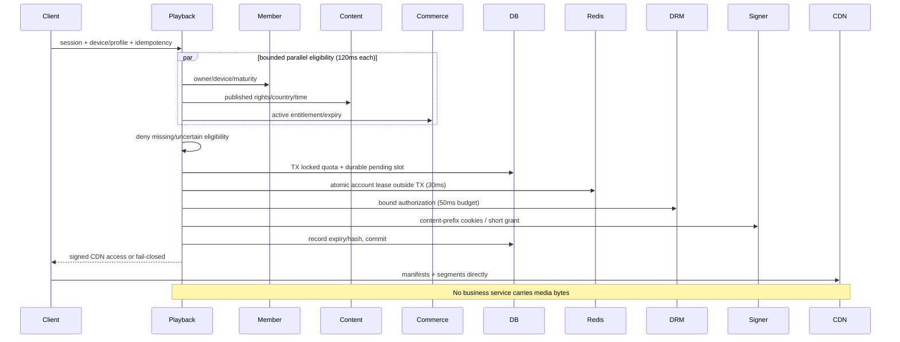
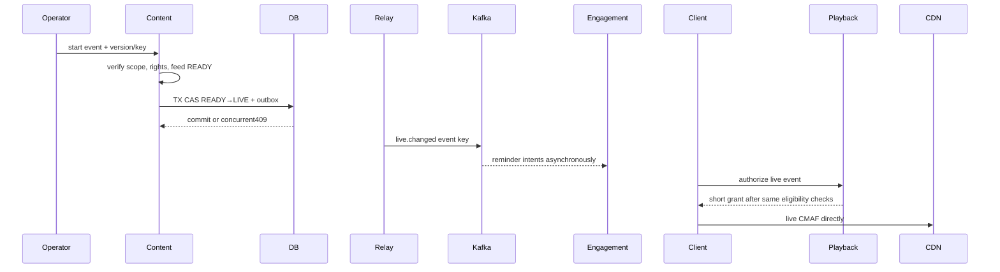

# Critical runtime sequence diagrams

Arrows `->>` synchronous unless Kafka/Temporal boundary; broker events are asynchronous. Each diagram states relevant transaction, timeout and failure/idempotency points.

## 1. Authentication

```mermaid
sequenceDiagram
Client->>IdP: Authorization Code + PKCE / MFA
IdP-->>Client: signed access token
Client->>API: bearer JWT
API->>IdP: bounded JWKS refresh (2s; cache known keys)
API->>API: verify issuer/audience/signature/time
API->>DB: TX insert issuer+sub ON CONFLICT / account lookup
DB-->>API: commit
API-->>Client: owned account or 401/503; no password custody
```

## 2. Subscription and payment



## 3. Entitlement activation

```mermaid
sequenceDiagram
Provider->>API: verified payment outcome
API->>DB: TX inbox+payment+subscription+entitlement+outbox
DB-->>API: commit; duplicate event no-op
API-->>Provider: acknowledge after commit
Relay->>DB: claim bounded outbox
Relay->>Kafka: entitlement.changed keyed account
Kafka-->>Playback: at-least-once event
Playback->>Playback: increasing version, evict cache
Note over API,Playback: Local ACID only; no distributed2PC
```

## 4. Playback authorization



## 5. Media processing and publication

```mermaid
sequenceDiagram
Client->>Media: create scoped upload
Media-->>Client: private presigned S3 upload
Client->>S3: media bytes
Media->>Temporal: idempotent workflow ID
Temporal->>Worker: probe, configured transcode/package (bounded activity retries)
Worker->>Worker: sandbox FFprobe/FFmpeg + QC
Worker->>S3: immutable package/checksums
Worker->>DB: TX ready asset + outbox
Relay->>Kafka: media.ready
Kafka-->>Content: idempotent ready consumer
Content->>DB: TX validated publication + catalog outbox
Note over Worker,Content: Partial package never published; failed job resumable
```

## 6. Search indexing

```mermaid
sequenceDiagram
Content->>DB: TX immutable catalog version + outbox
Relay->>Kafka: catalog.published content key
Kafka-->>Indexer: at-least-once event
Indexer->>Indexer: dedupe/version guard
Indexer->>OpenSearch: external-version write (500ms)
Indexer->>DB: persist checkpoint after index ack
Note over Indexer,OpenSearch: transient retry≤5 then DLQ; replay safe
Client->>Search: query
Search->>OpenSearch: bounded filtered query
Search-->>Client: results or explicit503
```

## 7. Watch progress

```mermaid
sequenceDiagram
Client->>Experience: profile/content/session epoch/sequence
Experience->>Member: profile owner check (120ms)
Experience->>DB: TX conditional epoch/sequence upsert + outbox
DB-->>Experience: updated or stale/duplicate no-op
Experience-->>Client: current resume position
Relay->>Kafka: watch.updated
Kafka-->>Insights: idempotent signal aggregation
Note over Experience,Insights: Newer rewind accepted; old session cannot overwrite
```

## 8. Live event start



## 9. Payment webhook

```mermaid
sequenceDiagram
Provider->>API: raw bytes + signature + timestamp
API->>API: constant-time verify, max5m drift, parse bounded body
API->>DB: TX lock order + UNIQUE provider/event inbox
API->>API: amount/currency/ref + allowed transition
alt valid new event
API->>DB: payment+entitlement+audit+outbox commit
API-->>Provider: 2xx after commit
else duplicate equal body
API-->>Provider: 2xx without effects
else invalid/collision/out-of-order resurrection
API-->>Provider: reject/quarantine; no activation
end
Note over API,DB: DB failure rolls back inbox/state; provider retries safely
```

## 10. Concurrent playback race

```mermaid
sequenceDiagram
ClientA->>Playback: acquire account sessionA
ClientB->>Playback: acquire same account sessionB
Playback->>DB: TX quota lock reserveA, cap reached
Playback->>DB: TX reserveB rejects cap
Playback->>Redis: Lua TIME/purge/count/reserveA
Redis-->>Playback: accepted remaining cap0
Playback->>Redis: Lua TIME/purge/count/reserveB
Redis-->>Playback: CONCURRENT_STREAM_LIMIT_REACHED
Playback->>DB: sessionA grant ledger
Playback-->>ClientA: grant expiry≤60s
Playback-->>ClientB: 409/403 no grant
Note over Redis,DB: Redis loss: durable slots retain capacity; lost lease renewal denied. Stale DB restore requires fencing/quarantine.
ClientA->>Playback: heartbeat30s, cannot resurrect expired
Playback->>Redis: owner/session checked renewal lease90s
```
